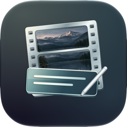

# Subler Neo



Subler Neo 1.0 (build 5) is a separate Apple Silicon-only app based on official Subler 1.9.5, with modernized dependencies, targeted correctness fixes and the approved layered Icon Composer icon. Requires macOS 13 or newer.

Its preferences, cache, queue, presets and OCR downloads use the separate identity `dk.nicklauritzen.SublerNeo`. No automatic migration from Subler is performed. Credits and licenses are retained.

## Build

```sh
git clone --branch neo/apple-silicon --recurse-submodules https://github.com/NickLauritzenDK/Subler.git
cd Subler
bash scripts/build-neo.sh
```

Requires an Apple Silicon Mac, Xcode and Python 3. The script downloads pinned sources/tools, builds arm64 dependencies, runs targeted regressions and packages a locally signed test app. It does not install the app or publish a release.

The test app is ad-hoc signed, not notarized. Neo's own signed update service is not configured; automatic updates are disabled and the official Subler feed is not used.

[Current status and remaining work](docs/STATUS.md) · [Build/verification history](MODERNIZATION.md) · [Neo identity](NEO.md) · [Tests](Tests/README.md)

## Historical upstream project information

### What is this repository for? ###

Subler is an Mac OS X app created to mux and tag mp4 files. The main features includes:

* Creation of tx3g subtitles tracks, compatible with all Apple's devices (iPod, AppleTV, iPhone, QuickTime?).
* Mux video, audio, chapters, subtitles and closed captions tracks from mov, mp4 and mkv.
* Raw formats: H.264 Elementary streams (.h264, .264), AAC (.aac), AC3 (.ac3), Scenarist (.scc), VobSub? (.idx).
* metadata editing and TMDb, TVDB and iTunes Store support.

### Build and run

Clone the repository and include all submodules
```
git clone --recurse-submodules https://github.com/SublerApp/Subler.git
```
If you already cloned without submodules and need to add the submodules manually, `cd` into the `./Subler` directory and clone the dependency submodules with 
```
git submodule update --init --recursive
```
Open `Subler.xcodeproj` in XCode

Build and run the project by selecting the 'Subler' scheme (`Product` -> `Scheme` -> `Subler`) and clicking the 'Run' button in Xcode’s toolbar.


### Subler Neo local build

On Apple Silicon, run `bash scripts/build-neo.sh`. This builds `build/neo/DerivedData/Build/Products/Release/Subler Neo.app` and runs native arm64 checks. See [MODERNIZATION.md](MODERNIZATION.md) for pinned dependencies, reproduction and historical verification scope.
